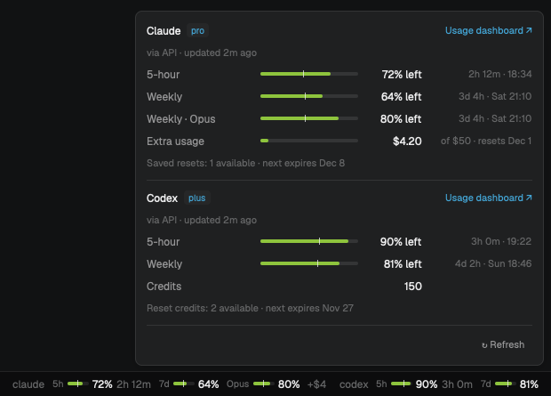

# AI usage

A status-bar block with how much of each Claude and Codex plan window is left, for the accounts signed in on the active space's machine. Agents on a remote machine spend that machine's accounts, so a space on it shows those. It reads the same numbers as Claude Code's `/usage` and Codex's rate-limit report, and refreshes every 5 minutes.



## What you see

- A 28px block on the `chrome` background with a 1px `border` line on top, sized to sit in a status row. 440px fits Claude's three windows and Codex's two at their widest: every window at 100% and a six-letter model name take about 395px of text.
- Right-aligned, 14px side padding, text 11.8px: `claude  5h 72%  7d 64%  Opus 80%    codex  5h 90%  7d 81%`. The account names and window labels are `dim`. Each percentage is what is left of that window (100% = unused): `foreground`, `ansi3` (amber) at 25% or less, `ansi1` (red) at 10% or less.
- Claude's windows: `5h` (session), `7d` (weekly, all models), and a weekly window scoped to one model, labeled with the model's name, when the plan has one. Codex's: its primary and secondary windows, labeled by length (`5h`, `7d`).
- Hovering an account shows when each window resets: `claude: % of each window left · 5h resets in 2h 10m · 7d resets in 3d 5h · …`.
- An account that can't be read is left out. With neither, the bar is empty.

## How it behaves

- Agent statuses play no part. No clicks or keys, only the hover.
- A 1s timer checks whether the active space's machine is due: never read, or read 5 minutes ago. A failed read is retried after 1 minute. One probe at a time.
- The last reading of every machine is kept, so a space switch shows that machine's accounts at once. It probes again only when that machine is due, since Anthropic's endpoint throttles frequent polling.
- A probe takes about 2 to 3 seconds; the bar keeps the previous reading until it lands.

## Built from

- `mods/ai-usage/mod.json`: `place: none`, title "AI usage".
- `mods/ai-usage/probe.js`: `PROBE`, a sh script with two sections, each printed after a `--- claude` or `--- codex` line.
  - claude: the OAuth token from `$CLAUDE_CONFIG_DIR/.credentials.json` or `~/.claude/.credentials.json`, else the macOS Keychain item `Claude Code-credentials` (`security find-generic-password -w`). Only the `accessToken` inside `claudeAiOauth` is taken: the same JSON holds one per signed-in MCP server. `GET https://api.anthropic.com/api/oauth/usage` with `Authorization: Bearer <token>` and `anthropic-beta: oauth-2025-04-20`. The headers go to curl on stdin (`-H @-`), so the token is never on a command line.
  - codex: `codex app-server` over stdio JSON-RPC: `initialize`, `initialized`, then `account/rateLimits/read` (id 2), printing the id 2 line.
  - `parse` reads Claude's `limits` array (`kind` `session`, `weekly_all`, `weekly_scoped` with `scope.model.display_name`; `percent` used; `resets_at`), falling back to `five_hour` and `seven_day` (`utilization`). It reads Codex's `rateLimits.primary` and `.secondary` (`usedPercent`, `windowDurationMins`, `resetsAt` in seconds). `until` formats a reset time.
- `mods/ai-usage/main.js`: a `View` with `init`, `tick` and `render`. It uses `exec("sh", ["-c", PROBE], { on, timeout: 30000 })` on the active space's machine, `theme()` tokens `chrome`, `border`, `dim`, `foreground`, `ansi3`, `ansi1`, `.tooltip`, `cx.timer.every`, `cx.spawn`, `cx.notify` and `checking()`.
- In a layout, a block in a 28px status row:
  ```json
  { "id": "ai-usage", "type": "block", "size": { "px": 440 }, "content": { "mod": "ai-usage" } }
  ```
- It runs `sh`, `sed`, `curl`, `codex`, `mktemp`, `sleep`, `touch` and, on macOS, `security`. It reads Claude Code's credentials and reaches `api.anthropic.com`, and Codex reaches its own servers.

## Watch out

- Claude's credentials JSON holds an `accessToken` for every MCP server signed in as well. Matching any `accessToken` would, depending on key order, send another service's token to `api.anthropic.com`. The match is anchored to `claudeAiOauth` and runs on the JSON with newlines removed. If that object ever gains a nested object before `accessToken`, the match finds nothing and Claude drops out, rather than picking a wrong token.
- `/api/oauth/usage` is undocumented and may change. Its `limits` array is newer than `five_hour`/`seven_day`; both are handled.
- It never refreshes Claude's token. A running `claude` on that machine keeps it fresh. With none for a while, the token expires and Claude drops out until one runs. Refreshing it here could race the CLI's token rotation and sign it out.
- `codex app-server` quits at the end of its input before it answers. The probe holds the input open until the id 2 line arrives (at most 15s), and app-server then takes about 1.5s to exit.
- `exec` with `on` runs through that machine's herdr-core, with the core's environment: `codex` and `curl` must be on the core's `PATH`.
- The macOS Keychain read can raise an access prompt if the item's access list doesn't include `security`.
- Values wider than the block spill out to the left: give it more width if a plan has more windows.

## Done when

- `herdr-app check mods/ai-usage` passes.
- In a space whose machine has signed-in `claude` and `codex`, the bar shows the same percentages left as `/usage` in Claude Code and `/status` in Codex.
- Hovering `claude` shows each window's reset time.
- With Codex signed out on that machine, only `claude` shows. With neither, the bar is empty.
- Switching spaces between two machines shows each one's accounts without a new probe until 5 minutes have passed.
