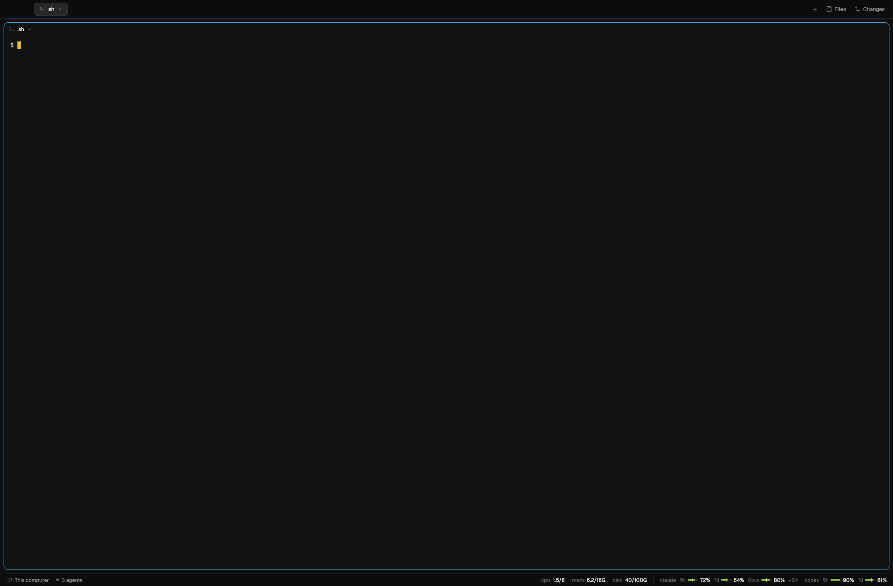

# Main with stats

Herdr's own `main` layout, unchanged except for its status bar. The single `workspace-status` block becomes a row: the shipped workspace status on the left, then [AI usage](../ai-usage) (Claude and Codex plan windows left) and [Pod stats](../pod-stats) (cpu, memory and disk against the machine's own limits). Both follow the active space's machine.



## What you see

- Everything above the status bar is Herdr's `main` as of 0.1.16: the sidebar with spaces and agents, tabs, and the pane area with the files and changes panel.
- The 28px status bar, left to right:
  - `workspace-status` (weight 1): the shipped block, taking the free width.
  - `ai-usage` (360px): `claude 5h 86% 7d 85% Fable 88%  codex 7d 100%`.
  - `pod-stats` (300px): `cpu 0.7/16 mem 12.1/32G disk 86/197G`.
- In a space on a machine without cgroup v2 (macOS), `pod-stats` is empty. In one without signed-in agents, `ai-usage` is empty.

## How it behaves

- As `main` does, plus the two mods: see their recipes. Neither takes clicks or keys; `ai-usage` has a hover with reset times.

## Built from

- `layouts/main-stats.json`: a clone of the shipped `main` (`cloned_from: {name: "main", version: "0.1.16"}`). Its `status` block (28px, `workspace-status`) is replaced by:
  ```json
  { "id": "status-row", "type": "row", "size": { "px": 28 }, "resizable": false, "children": [
    { "id": "status", "type": "block", "size": { "weight": 1 }, "content": { "mod": "workspace-status" } },
    { "id": "ai-usage", "type": "block", "size": { "px": 360 }, "content": { "mod": "ai-usage" } },
    { "id": "pod-stats", "type": "block", "size": { "px": 300 }, "content": { "mod": "pod-stats" } } ] }
  ```
- The mods it needs are `../ai-usage/mods/ai-usage` and `../pod-stats/mods/pod-stats` in this repo. Copy both into `mods/`.

## Watch out

- Clones don't follow Herdr's updates to `main`. On a release that changes `main`, clone it again (`layout.clone {"name": "main", "as": "main-stats"}`, after moving this one aside) and redo the status row.
- The two fixed widths (660px together) suit a full-width window. In a narrow one, `workspace-status` gets what is left.

## Done when

- `herdr-app check` passes for both mods, and `layout.switch {"name": "main-stats"}` gives no `layout.error` in `herdr-app status`.
- The window looks like `main`, with AI usage and pod stats at the right of the status bar.
- `ctrl-shift-l` cycles back to the previous layout.
